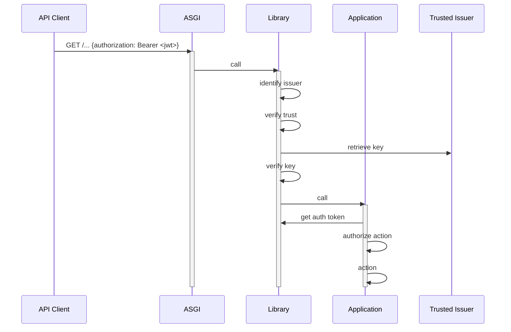

# fastapi-oauth-jwt

`fastapi-oauth-jwt` is a middleware implementation of [RFC-9068] that includes key retrieval and caching. The goal is
to support multiple retrieval methods and to enable the implementation of more complex auth schemes such as
[Eclipse Biscuits], capability-based attenuation, and revocation schemes on top of a simple, efficient library.
This is that library. It works together with the lifespan concept from [fastapi-runner] though the core implementation
is a simple middleware.

## Architecture

### Concepts

A **claim** is the primitive unit of authorization.[RFC-7519] describes how claims are encoded in JSON Web Tokens
and how they are verified. [RFC-9068] enumerates the required claims for the OAuth 2 profile. The token that the
application receives includes the claims from the bearer token after verification.

The token that the application receives also includes a reference to the **verification key** that was used to verify
the authenticity of the incoming token. Verification keys are public keys that are issued from _preconfigured_
**trusted issuers**. The library retrieves keys using one of a set of supported algorithms (such as HTTP retrieval of a
JSON Web Key Set) and caches them according to key metadata.

### Mechanics

The application receives the token from the library using FastAPI dependency injection. The token contains a list of
claims and a reference to the verification key which, in turn, has a reference to the issuer. The library ensures that
the token is trusted and temporally valid when the application receives it. In other words, the application _never_
receives an untrusted or expired token. That is the guarantee that token retrieval offers.

The application is responsible for determining whether the claims are sufficient to grant access to the requested
resource. The token instance includes helpers to verify claims and to perform point-in-time validity checks.

The library is configured with a set of trusted issuers identified by the standard `iss` claim. Each issuer configuration
describes how to retrieve verification keys from the issuer.

[RFC-7519]: https://www.rfc-editor.org/info/rfc7519
[RFC-9068]: https://www.rfc-editor.org/info/rfc9068
[Eclipse Biscuits]: https://doc.biscuitsec.org/home.html
[fastapi-runner]: https://pypi.org/project/fastapi-runner/
